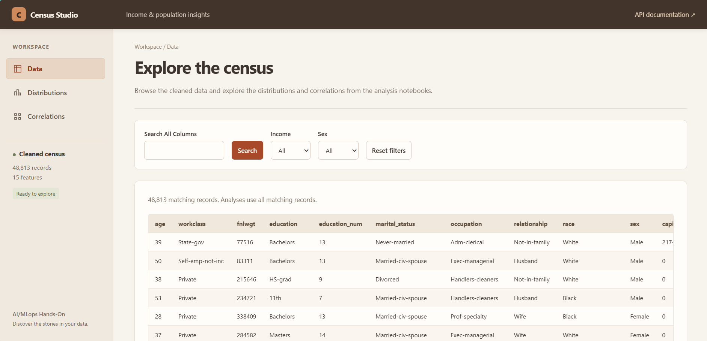

# Task 2 report: Application Development

| Field | Value |
| --- | --- |
| Student | Stefano |
| Dataset | census_income.csv |
| Task | 2 | 
| How to run | docker compose up --build -d |
| Timebox | 1h / finished |

## 1. Summary

The application built is a fullstack application with the follwing technologies:
- frontend: React
- backend: FastAPI
- Deployment: Docker compose
- communication: Nginx

The application replicate the analysis created in task1 and shows them in an interactive frontend with React.

## 2. Goal and success criteria

**Goal.** Creation of an application used to navigate data of the chosen dataset

| Criterion | How it is measured | Target | Result |
| --- | --- | --- | --- |
| data navigation | apllication functioning | fullstack application | functioning application |

**Evidence:** 

  

in the image the functioning application

## 3. Approach and key decisions

| # | Finding | Decision | Alternative considered | Where in the code |
| --- | --- | --- | --- | --- |
| D1 | need for a backend | use FastAPI | Django | src/backend |
| D2 | need for a frontend | React | - | src/frontend |
| D3 | need of communication backend-frontend | Nginx | - | src/frontend/nginx.conf |
| D4 | need to show data | use finding of task1 | - | src/backend/data.py |

**Evidence:** 
the application

## 8. Use of AI assistants

| Tool | What you used it for | Where (files or sections) | How you checked the output |
| --- | --- | --- | --- |
| Codex | generation of boilerplate | - | tests,manual check |
| Codex | creation of endpoints and frontend | - | tests,manual check |
| Codex | creation of test | - | manual check |

## Checklist

- [X] Task tag pushed and named in the table at the top
- [X] Runs from a fresh clone with the commands above
- [X] No secrets, API keys or large data files committed
- [X] Every section has an Evidence line
- [X] Every figure has a caption with a number
- [X] Guidance blocks and placeholders removed
- [X] `AI_LOG.md` up to date
